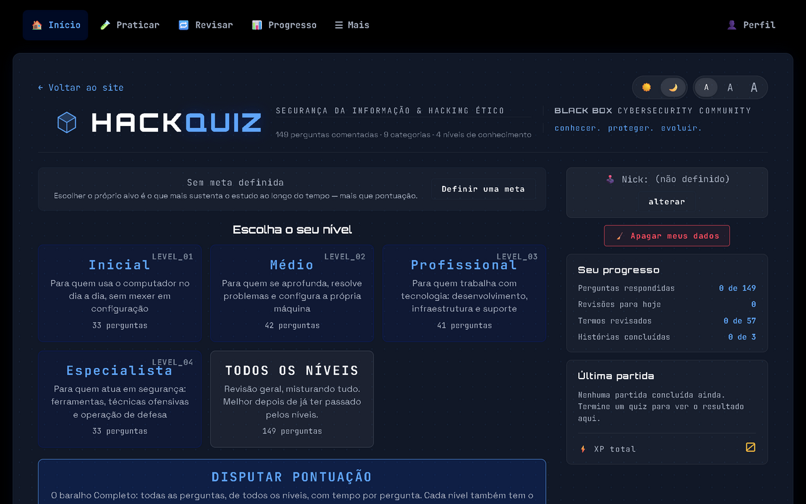
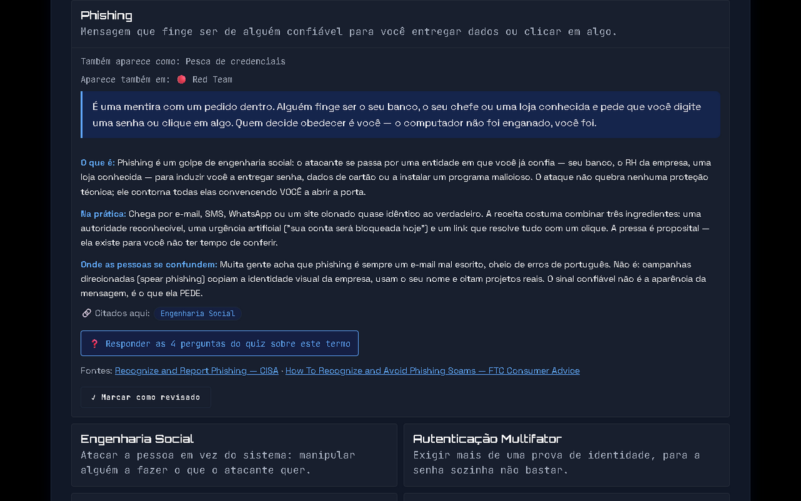
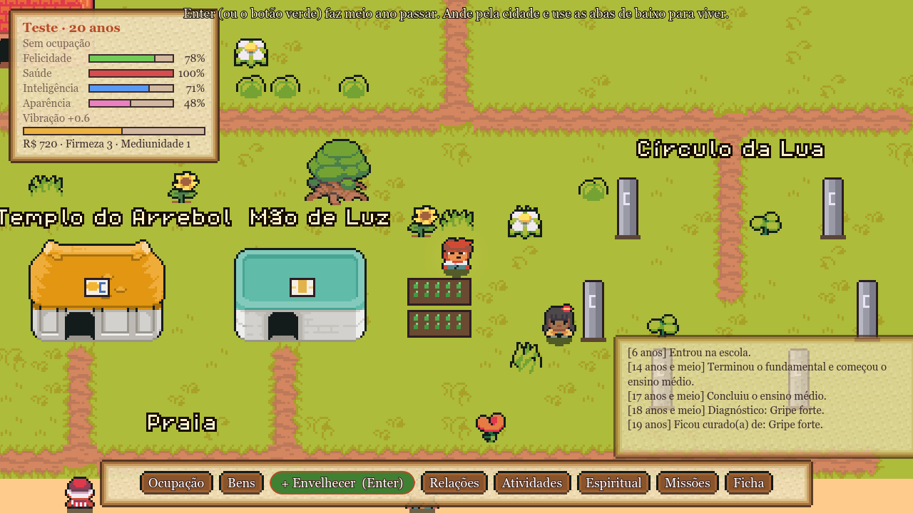
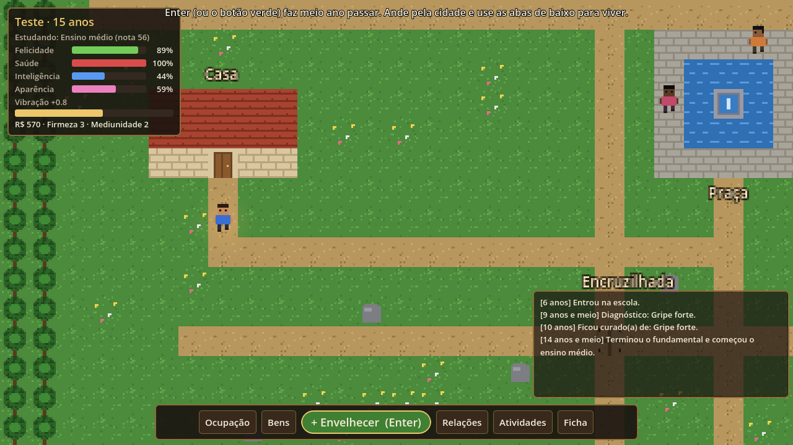
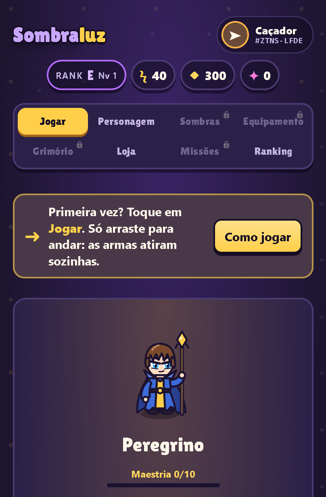
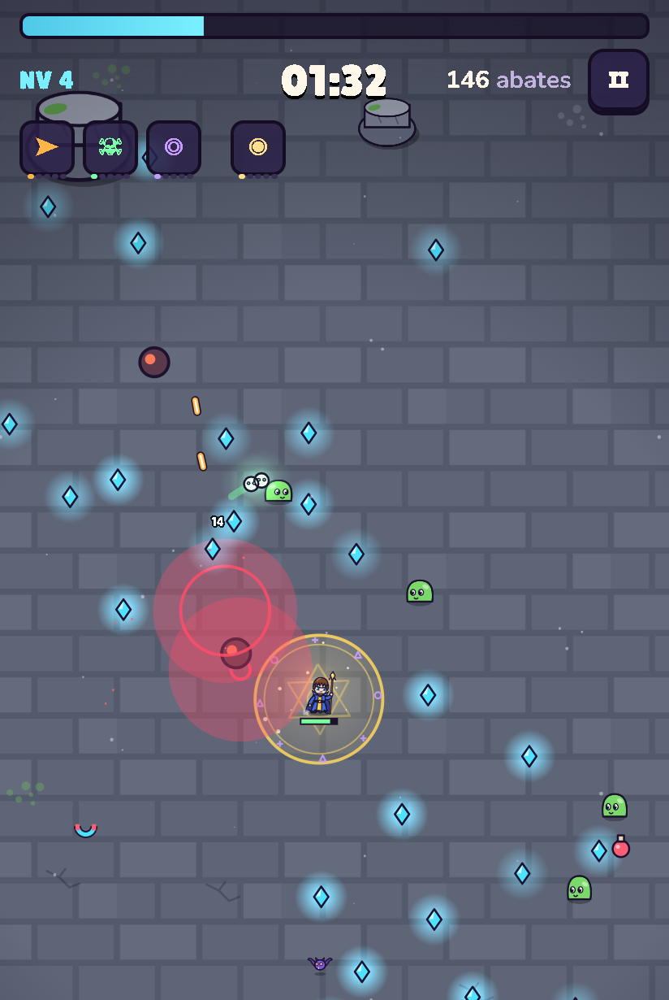

 

<h1 align="center">Saudações, eu sou O Azevedo </h1>
<h2 align="center"> abaixo são coisas que sei fazer: </h2>

  <b>Cibersegurança e desenvolvimento web</b> · jogos · engenharia assistida por IA 
  Security-minded web & game developer shipping tested, versioned projects with AI-assisted engineering.

  
  
  
  
  
  
  
  
  
  

---

Construo projetos **do começo ao fim**: código, testes, segurança, publicação
e versão. Tudo o que está abaixo roda de verdade, com link para abrir agora.

> 🔒 Os repositórios são privados. Os projetos estão publicados nos links
> abaixo, e o código pode ser mostrado sob solicitação, numa entrevista ou
> avaliação técnica.

## 🛡️ HackQuiz 

**[▶ Abrir o app](https://hackquiz-blackbox.vercel.app)** · HTML/CSS/JS puro · Firebase · Electron · Vercel

Plataforma de estudo de segurança da informação: **173 perguntas em 9 matérias**,
cada uma com uma explicação pesquisada e fontes oficiais citadas, **30 exercícios
práticos** e um vocabulário de 57 termos.

**O que ele ensina**

| Área | Exemplos |
|---|---|
| Red Team e Blue Team | cadeia de ataque, engenharia social, detecção, resposta a incidentes |
| Redes | sub-rede, ARP, MITM, DoS, Wi-Fi (WPA2, Evil Twin) |
| Criptografia | hash, assinatura digital, certificados TLS, ponta a ponta |
| Forense, GRC e Direito Digital | cadeia de custódia, ISO 31000, matriz de risco, LGPD e escopo de pentest |
| Linux e Windows | `/etc/passwd`, SUID, crontab, `ps`, `ss`, tarefas agendadas |

**Exercícios sobre artefatos reais, não decoreba:** ler a saída do `nmap`, achar
o IOC num log com `grep`, auditar os `Set-Cookie` de um login, achar a conta com
UID 0 que não se chama `root`. Os números mudam a cada tentativa, e cada etapa é
verificada.

**A segurança do próprio app**

- **Sem backend:** as regras do Firestore são a única barreira, e uma suíte de **133 ataques no emulador** prova os dois lados, com todo ataque negado e todo uso legítimo aceito.
- Achei e corrigi falhas reais: um **XSS armazenado** e uma **injeção de código por U+2028** num gerador de trechos (o caractere invisível fazia texto da comunidade virar código).
- **CSP sem `unsafe-inline`**, cabeçalhos anti-clickjacking e HSTS, e a janela desktop que não navega para fora do app.

**Engenharia:** 10 suítes de teste num runner próprio, auditoria de **contraste
WCAG AA** e de acessibilidade por teclado, CI em todo pull request, e um auditor
que reprova a documentação quando ela diverge do código.

---

## 🌀 RPG Espiritual 

**[▶ Jogar no navegador](https://rpg-espiritual.vercel.app)** · Godot 4 · GDScript · instalador para Windows

RPG 2D em pixel art no estilo BitLife: você vive meio ano por vez, estuda,
trabalha, forma família e escolhe um caminho espiritual; depois da morte o jogo
continua no plano espiritual, até reencarnar. Instalador próprio (Inno Setup),
exportação para web e releases versionadas.

---

## ⚔️ Sombraluz

**[▶ Jogar no navegador](https://sombraluz.vercel.app)** · HTML5 Canvas · JavaScript puro · Capacitor · Electron

Survivor-like para celular e navegador: você só move o personagem, as armas
atiram sozinhas, e a cada nível escolhe uma carta. Entre as partidas há classes,
equipamentos com raridade, missões e loja.

  
  &nbsp;&nbsp;
  

- Sem engine: o mesmo código vira **site, APK Android e instalador Windows**.
- Lógica coberta por testes e por uma **simulação com bot** que joga em velocidade acelerada para testar o balanceamento.
- Cada tag publica o APK, o `.exe` e o build web pelo GitHub Actions.

---

## 🔧 Outros projetos

| Projeto | O que é | Stack |
|---|---|---|
| **[Runas & Hordas](https://runas-e-hordas.vercel.app)** | Survivor-like de fantasia medieval em pixel art, com 12 armas | HTML5 Canvas · JavaScript · Capacitor |
| **Firewall FPS** *(em desenvolvimento)* | FPS cooperativo de sobrevivência contra hordas | Unity 6 · C# · FishNet (multiplayer) |
| **APP Financeiro** *(em desenvolvimento)* | Plataforma de educação e organização financeira, em PT e EN | Next.js 16 · TypeScript · Prisma · PostgreSQL |

## 🤖 Como eu trabalho: engenharia assistida por IA

Uso IA (**Claude Code**) como parte do processo, não como atalho. O que faz
isso funcionar é a parte que continua sendo minha: decidir, verificar e manter.

- **Cada projeto tem um guia de decisões** com o *porquê* de cada escolha, para nenhuma mudança desfazer uma decisão sem saber.
- **Nada entra sem verificação:** testes automatizados, auditorias de contraste e acessibilidade, testes de ataque às regras de segurança e CI em todo pull request.
- **Agentes com papéis separados** no HackQuiz: pesquisa de currículo, autoria, revisão que reabre as fontes e auditoria. Quem escreve não aprova o próprio trabalho.
- **Fluxo de produção:** branch, pull request, CI verde, versão semântica e release com os arquivos de cada versão.

## 📫 Contato

Quer ver o código de algum projeto ou conversar sobre uma vaga? Me chame pelo GitHub.
