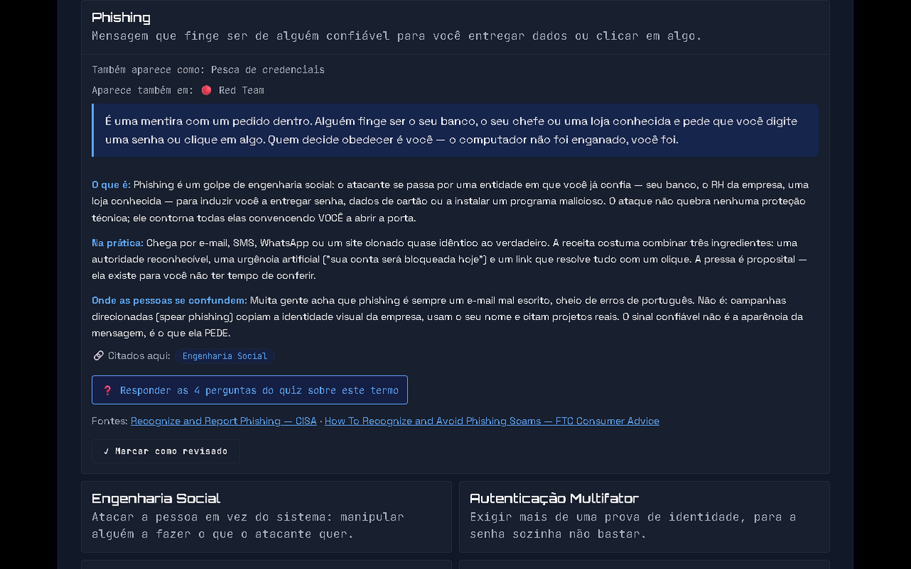
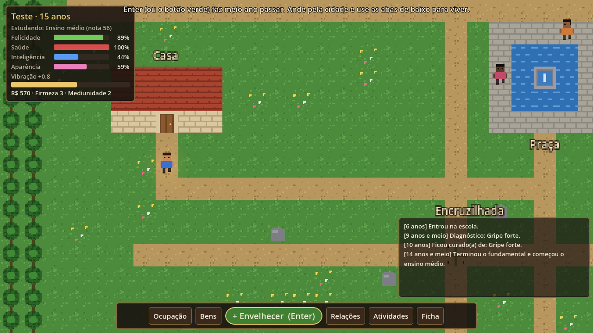
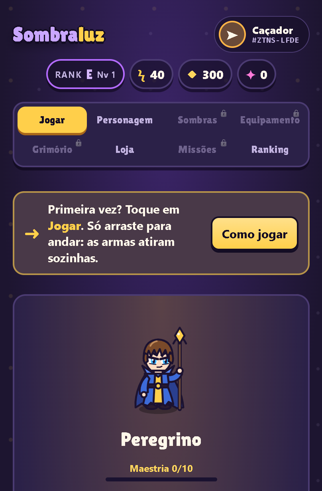
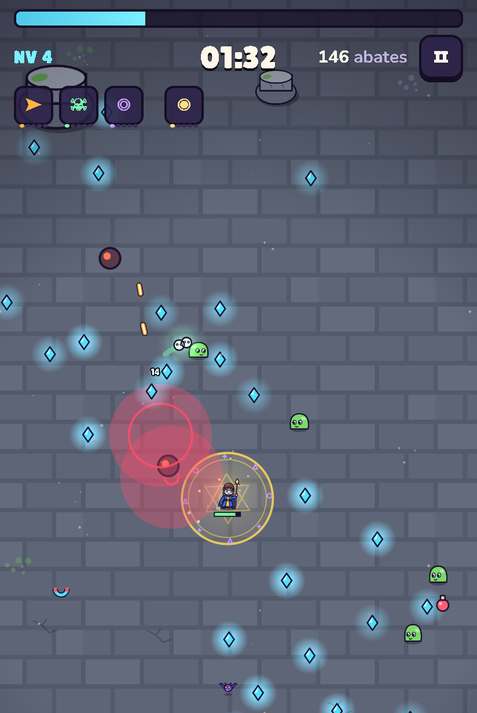

<h1 align="center">Saudações, eu sou O Azevedo</h1>

  <b>Pesquisador de cibersegurança</b> · testes de software · desenvolvimento web e jogos 
  Security researcher & software tester · cybersecurity student · building tested, versioned projects with AI-assisted engineering.

  
  
  
  
  
  
  
  
  
  
  
  
  
  
  

  <a href="#-sobre-mim">Sobre mim</a> ·
  <a href="#️-hackquiz">HackQuiz</a> ·
  <a href="#-ilumbá">Ilumbá</a> ·
  <a href="#️-sombraluz">Sombraluz</a> ·
  <a href="#-outros-projetos">Outros projetos</a> ·
  <a href="#-como-eu-trabalho-engenharia-assistida-por-ia">Como eu trabalho</a>

---

Construo projetos **do começo ao fim**: código, testes, segurança, publicação
e versão. Tudo o que está abaixo roda de verdade, com link para abrir agora.

## 👤 Sobre mim

- 🎓 **Curso cibersegurança na faculdade** e estudo segurança ofensiva e defensiva na prática.
- 🔍 **Pesquisador de cibersegurança:** procuro falhas nos meus próprios projetos antes de publicar (XSS, injeção, regras de banco, cabeçalhos HTTP) e documento como corrigi.
- 🚩 **CTFs e TryHackMe:** participo de competições CTF e treino no TryHackMe.
- 🧪 **Testes de software:** testes unitários e de integração, testes de ataque a regras de segurança, simulações automatizadas, auditorias de acessibilidade e CI em todo pull request.
- 🐞 **Próximo passo: bug bounty.** Ainda não tenho CVE registrada; estou me preparando para começar em programas de bug bounty em breve, sempre dentro do escopo e com divulgação responsável.

| Área | O que já faço |
|---|---|
| **Segurança de aplicações web** | OWASP Top 10, XSS, injeção, CSP, HSTS, anti-clickjacking, revisão de cookies e cabeçalhos |
| **Controle de acesso** | regras do Firestore testadas com ataques no emulador, validação no servidor, sessões e códigos de acesso únicos |
| **Testes e QA** | suítes automatizadas, testes de regressão, simulação com bot, compatibilidade de saves, acessibilidade (WCAG AA) |
| **Fundamentos** | redes, criptografia, Linux e Windows, forense, GRC e LGPD (conteúdo que curei para o HackQuiz) |

## 📡 Em desenvolvimento agora
<!-- auto:status -->

| Projeto | Versão | Lançada em | Commits (30 dias) | Site |
|---|---|---|---|---|
| **[HackQuiz](https://hackquiz-blackbox.vercel.app)** | v1.5.3 | 23/10/2026 | 124 |  |
| **[Ilumbá](https://rpg-espiritual.vercel.app)** | v0.87.0 | (Beta) | 139 |  |
| **[Sombraluz](https://sombraluz.vercel.app)** | v0.41.0 | (Beta) | 122 |  |

<!-- /auto:status -->
Esta tabela e os números dos projetos se atualizam sozinhos todo dia, por um
GitHub Action deste repositório. Última mudança: <!-- auto:atualizado -->06/11/2026<!-- /auto:atualizado -->.

> 🔒 Os repositórios são privados. Os projetos estão publicados nos links
> acima, e o código pode ser mostrado sob solicitação, numa entrevista ou
> avaliação técnica.

## 🛡️ HackQuiz

**[▶ Abrir o app](https://hackquiz-blackbox.vercel.app)** · <!-- auto:hackquiz-versao -->v1.5.3<!-- /auto:hackquiz-versao --> · HTML/CSS/JS puro · Firebase · Vercel

Plataforma de estudo de segurança da informação em português:
**<!-- auto:hackquiz-perguntas -->173<!-- /auto:hackquiz-perguntas --> perguntas em <!-- auto:hackquiz-materias -->9<!-- /auto:hackquiz-materias --> matérias**,
cada uma com uma explicação pesquisada e fontes oficiais citadas,
**<!-- auto:hackquiz-exercicios -->30<!-- /auto:hackquiz-exercicios --> exercícios práticos** e um vocabulário de
<!-- auto:hackquiz-termos -->57<!-- /auto:hackquiz-termos --> termos. A proficiência é medida por competência, e a
repetição espaçada traz de volta o que você errou.

| Área | Exemplos |
|---|---|
| Red Team e Blue Team | cadeia de ataque, engenharia social, detecção, resposta a incidentes |
| Redes | sub-rede, ARP, MITM, DoS, Wi-Fi (WPA2, Evil Twin) |
| Criptografia | hash, assinatura digital, certificados TLS, ponta a ponta |
| Forense, GRC e Direito Digital | cadeia de custódia, ISO 31000, matriz de risco, LGPD e escopo de pentest |
| Linux e Windows | `/etc/passwd`, SUID, crontab, `ps`, `ss`, tarefas agendadas |

**Exercícios sobre artefatos reais, não decoreba:** ler a saída do `nmap`, achar
o IOC num log com `grep`, auditar os `Set-Cookie` de um login, achar a conta com
UID 0 que não se chama `root`. Os números mudam a cada tentativa, e cada etapa é
verificada.

<b>Ver o vocabulário</b> (verbete Phishing)

 

**A segurança do próprio app**

- **Sem backend:** as regras do Firestore são a única barreira, e uma suíte de **133 ataques no emulador** prova os dois lados, com todo ataque negado e todo uso legítimo aceito.
- Achei e corrigi falhas reais: um **XSS armazenado** e uma **injeção de código por U+2028** num gerador de trechos (o caractere invisível fazia texto da comunidade virar código).
- **CSP sem `unsafe-inline`**, cabeçalhos anti-clickjacking e HSTS.

**Engenharia:** 10 suítes de teste num runner próprio, auditoria de **contraste
WCAG AA** e de acessibilidade por teclado, CI em todo pull request, e um auditor
que reprova a documentação quando ela diverge do código.

---

## 🌀 Ilumbá

**[▶ Jogar no navegador](https://rpg-espiritual.vercel.app)** · <!-- auto:rpg-versao -->v0.87.0<!-- /auto:rpg-versao --> · Godot 4 · GDScript · exportação web

RPG 2D em pixel art no estilo BitLife (antes chamado RPG Espiritual): você vive meio ano por vez, estuda,
trabalha, forma família e escolhe um caminho espiritual. Depois da morte, o jogo
continua no plano espiritual, um lugar de trabalho e aprendizado, até reencarnar.

- **Duas fases jogáveis:** a vida inteira e o pós-vida, com Abrigo, Umbral, Colônia e falanges.
- **Conteúdo em dados:** eventos, empregos, falas, missões e ervas em JSON, separados do código.
- **Testado sem abrir o jogo:** o CI simula 300 vidas a cada pull request e roda mais 13 suítes de regras, incluindo a compatibilidade com saves antigos.
- **Cuidado com o jogador:** o pós-vida nunca é recompensa por morrer, e o contato do CVV (188) fica sempre no menu.
- Exportado do Godot para a web: roda no navegador, sem instalar nada, com releases versionadas.

<b>Ver o mapa da cidade</b>

 

---

## ⚔️ Sombraluz

**[▶ Jogar no navegador](https://sombraluz.vercel.app)** · <!-- auto:sombraluz-versao -->v0.41.0<!-- /auto:sombraluz-versao --> · HTML5 Canvas · JavaScript puro · Firebase · PWA

Survivor-like para celular e navegador: você só move o personagem, as armas
atiram sozinhas, e a cada nível escolhe uma carta. Entre as partidas há uma
cidade com ferraria, mercado e guildas, classes, equipamentos com raridade e
nível, missões e ranking online.

  
  &nbsp;&nbsp;
  

- Sem engine nem framework: Canvas e JavaScript puro, e um **PWA** que se instala pelo navegador e roda offline.
- Lógica coberta por mais de 130 testes e por uma **simulação com bot** que joga em velocidade acelerada para testar o balanceamento.
- **Ranking online protegido pelas regras do Firestore:** cada jogador só escreve a própria pontuação, só para cima e dentro de limites plausíveis.
- Cada tag gera o build web versionado pelo GitHub Actions, e o site na Vercel é o único canal do jogo.

---

## 🔧 Outros projetos

| Projeto | O que é | Stack |
|---|---|---|
| **[Runas & Hordas](https://runas-e-hordas.vercel.app)** | Survivor-like de fantasia medieval em pixel art, com 12 armas | HTML5 Canvas · JavaScript · Capacitor |
| **Firewall FPS** *(em desenvolvimento)* | FPS cooperativo de sobrevivência contra hordas | Unity 6 · C# · FishNet (multiplayer) |
| **APP Financeiro** *(em desenvolvimento)* | Plataforma de educação e organização financeira, em PT e EN | Next.js 16 · TypeScript · Prisma · PostgreSQL |
| **Tharveth** *(em desenvolvimento, nome provisório)* | RPG de fantasia medieval sombria para Roblox, com testes de lógica e simulação de combate com latência | Luau · Rojo · Lune · Selene |
| **Minha Retrospectiva 2026** | Quiz pessoal de 20 perguntas com leitura individual feita por regras (sem IA). Acesso por código único ligado ao e-mail e validado no servidor, sem sessões simultâneas | Cloudflare Pages · Functions · D1 · JavaScript |

## 🤖 Como eu trabalho: engenharia assistida por IA

Uso IA (**Claude Code**) como parte do processo, não como atalho. O que faz
isso funcionar é a parte que continua sendo minha: decidir, verificar e manter.

- **Cada projeto tem um guia de decisões** com o *porquê* de cada escolha, para nenhuma mudança desfazer uma decisão sem saber.
- **Nada entra sem verificação:** testes automatizados, auditorias de contraste e acessibilidade, testes de ataque às regras de segurança e CI em todo pull request.
- **Agentes com papéis separados** no HackQuiz: pesquisa de currículo, autoria, revisão que reabre as fontes e auditoria. Quem escreve não aprova o próprio trabalho.
- **Fluxo de produção:** branch, pull request, CI verde, versão semântica e release com os arquivos de cada versão.
- **Até este perfil é automatizado:** a tabela do topo e os números do HackQuiz são lidos dos projetos todo dia, em vez de envelhecerem à mão.

## 📫 Contato

Quer ver o código de algum projeto, conversar sobre uma vaga em segurança ou
QA, ou trocar ideia sobre bug bounty?
[Abra uma issue neste repositório](https://github.com/O-Azevedo/O-Azevedo/issues/new) que eu respondo.
