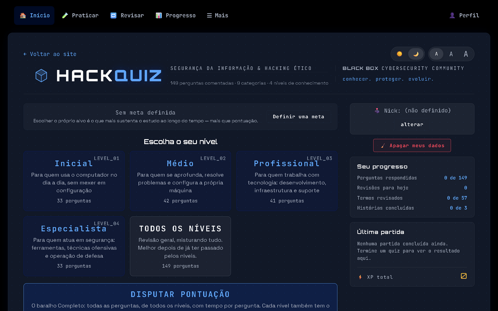
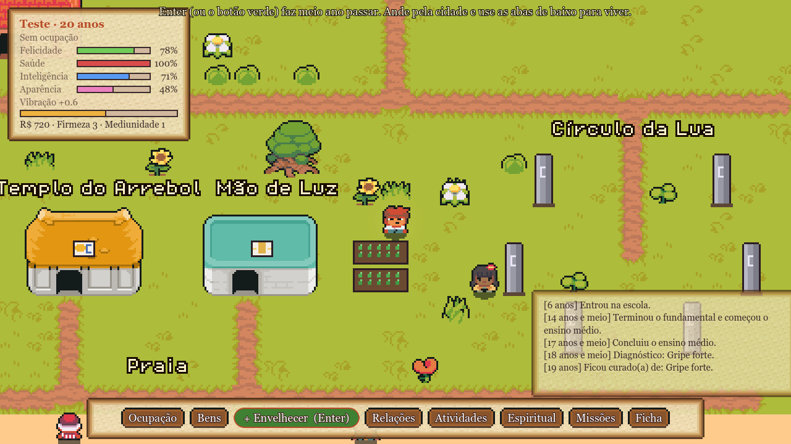

<h1 align="center">O Azevedo</h1>

  <strong>Segurança de aplicações · Qualidade de software · Desenvolvimento web e jogos</strong> 
  Da ideia à publicação: projetos funcionais, testados, versionados e construídos com atenção à segurança.

  <a href="#perfil">Perfil</a> ·
  <a href="#serviços-no-ar">Serviços</a> ·
  <a href="#projetos-em-destaque">Projetos</a> ·
  <a href="#situação-dos-projetos">Situação</a> ·
  <a href="#competências">Competências</a> ·
  <a href="#como-trabalho">Como trabalho</a> ·
  <a href="#contato">Contato</a>

  
  
  
  
  
  
  
  
  
  
  
  
  
  
  
  
  

---

## Perfil

Sou estudante de **cibersegurança**, desenvolvedor e entusiasta de qualidade de software. Trabalho na interseção entre **segurança, engenharia e experiência de uso**: entender o problema, construir a solução, integrar serviços, testar os casos esperados e os inesperados e deixar o projeto pronto para ser publicado e mantido.

Tenho **serviços em produção** (venda com pagamento, entrega e acesso controlado), além de ferramentas educacionais e jogos para navegador. Integro aplicações com **APIs e serviços externos** (Mercado Livre e Mercado Pago, com confirmação de pagamento validada no servidor) e uso **Cloudflare**, **Vercel** e **Neon (PostgreSQL)** para publicar e guardar dados.

Estudo segurança ofensiva e defensiva, participo de CTFs e treino no TryHackMe. Pratico apenas em sistemas próprios ou ambientes autorizados, com escopo definido e divulgação responsável.

## Serviços no ar

Produtos publicados e em operação, com pagamento, controle de acesso e dados pessoais tratados no servidor.

### 🔮 [Caminhos Abertos 2027](https://caminhos.abertos2027.workers.dev) — loja de análise personalizada

<!-- auto:caminhos-versao -->v1.0.0<!-- /auto:caminhos-versao --> · Next.js 16 · TypeScript · Cloudflare Workers · Neon (PostgreSQL) · Mercado Pago

Página de vendas de uma análise personalizada para 2027 (numerologia, Baralho Cigano e Tarot), entregue em áudios e PDF. O fluxo vai da venda à entrega sem planilha nem conferência manual de comprovante.

- **Formulário de personalização obrigatório** antes do pagamento, validado com Zod no navegador e de novo no servidor.
- **Pix e cartão dentro do site** pelo Checkout Transparente do Mercado Pago (API de Orders), sem o cliente precisar de conta.
- **O pedido só vira "pago" quando o servidor consulta o Mercado Pago** e confere status, valor, moeda e referência. Voltar para a página de sucesso ou mandar `status=approved` na URL não libera nada.
- Webhook com assinatura verificada e tolerante a duplicidade e a chegada fora de ordem; um cron reconcilia pagamentos cujo aviso se perdeu.
- Fila de entregas com envio em um clique por WhatsApp ou e-mail, área administrativa com sessão assinada, rate limit, proteção CSRF e limpeza dos dados de pedidos não pagos (LGPD).
- Testes de cada cenário de pagamento (aprovado, pendente, recusado, estorno, valor divergente, Mercado Pago fora do ar) com Vitest e PGlite, e CI com testes, tipos e build para Workers.

### 🪞 [Minha Retrospectiva 2026](https://minha-retrospectiva-2026.pages.dev) — experiência pessoal com acesso controlado

<!-- auto:retrospectiva-versao -->v0.5.1<!-- /auto:retrospectiva-versao --> · JavaScript · Cloudflare Pages · Functions · D1

Quiz de 15 perguntas, com vereditos escritos à mão, que devolve uma leitura individual, montada por regras que cruzam as respostas, sem IA. Vendido como produto digital, com cada compra recebendo um código próprio.

- **Acesso só por código individual**: no primeiro uso ele fica ligado ao e-mail e é recusado em qualquer outro.
- **Uma resposta por código, contada no servidor**: limpar o navegador ou trocar de aparelho não libera outra.
- Sem uso simultâneo: entrar em outro aparelho encerra a sessão anterior.
- Link de compartilhamento que mostra só o resultado, sem nome, e-mail ou respostas.
- Liberação de nova resposta pelo suporte com um workflow do GitHub Actions; deploy automático depois dos testes; dados guardados por prazo definido.

## Projetos em destaque

### 🛡️ [HackQuiz](https://hackquiz-blackbox.vercel.app) — aprendizagem em cibersegurança

<!-- auto:hackquiz-versao -->v1.5.3<!-- /auto:hackquiz-versao --> · HTML/CSS/JS · Firebase · Vercel

Plataforma em português para estudar segurança da informação por competências: **<!-- auto:hackquiz-perguntas -->173<!-- /auto:hackquiz-perguntas --> perguntas em <!-- auto:hackquiz-materias -->9<!-- /auto:hackquiz-materias --> matérias**, **<!-- auto:hackquiz-exercicios -->30<!-- /auto:hackquiz-exercicios --> exercícios práticos** e um glossário de <!-- auto:hackquiz-termos -->57<!-- /auto:hackquiz-termos --> termos, com explicações referenciadas e repetição espaçada.

- Red Team e Blue Team, redes, criptografia, Linux e Windows, forense, GRC e Direito Digital.
- Exercícios baseados em artefatos e cenários práticos, não apenas memorização.
- Regras do Firestore testadas no emulador, cobrindo acessos legítimos e tentativas não autorizadas.
- Correções de segurança reais no próprio app, como XSS armazenado e injeção causada pelo tratamento de caracteres Unicode.
- CSP sem `unsafe-inline`, cabeçalhos de segurança, auditoria de acessibilidade e CI.

### ⚔️ [Runas & Hordas](https://runas-e-hordas.pages.dev) — survivor-like para navegador

<!-- auto:runas-versao -->v0.24.0<!-- /auto:runas-versao --> · HTML5 Canvas · JavaScript puro · Cloudflare Pages

Ação de fantasia medieval com visual cartoon em vetor, para celular e PC direto no navegador. O herói só se move; as armas atacam sozinhas.

- **12 armas**, uma em cada mão, escolhidas e melhoradas no Arsenal ao longo da partida.
- Runas ativáveis, chefes por capítulo, santuários com bênçãos, maldições, pactos e eventos.
- Progressão entre partidas (atributos, equipamentos com raridade, missões e loja) e save na nuvem com conta Google.
- **96 testes** da lógica pura e uma simulação com bot em relógio acelerado.

### 🌅 [Ilumbá](https://ilumba.vercel.app) — RPG 2D de vida e pós-vida

<!-- auto:rpg-versao -->v0.87.0<!-- /auto:rpg-versao --> · Godot 4 · GDScript · exportação web

Simulação de vida em pixel art em que escolhas sobre estudo, trabalho, família e espiritualidade moldam a jornada, que continua depois da morte.

- Eventos, empregos, diálogos e missões em JSON, separados da lógica do jogo.
- Testes automatizados de regras e de compatibilidade com saves antigos.
- Simulações de vidas inteiras executadas no CI.

### Outros projetos

| Projeto | Descrição | Tecnologias |
|---|---|---|
| [Sombraluz](https://sombraluz.pages.dev) | Survivor-like com progressão, equipamentos, missões e ranking online | HTML5 Canvas · JavaScript · Firebase · PWA |
| Tharveth *(em desenvolvimento)* | RPG de fantasia sombria para Roblox, com testes de lógica e simulação de combate com latência | Luau · Rojo · Lune · Roblox Studio |
| Firewall FPS *(em desenvolvimento)* | FPS cooperativo de sobrevivência contra hordas | Unity 6 · C# · FishNet |
| [FinApp](https://finapp-six-topaz.vercel.app) *(MVP no ar)* | Educação e organização financeira em português e inglês, no ar como "Grana no Controle" (nome provisório) | Next.js · TypeScript · Prisma · PostgreSQL |

## Situação dos projetos

<!-- auto:status -->

| Projeto | Versão | Lançada em | Commits (30 dias) | Site |
|---|---|---|---|---|
| **[HackQuiz](https://hackquiz-blackbox.vercel.app)** | v1.5.3 | 29/10/2026 | — |  |
| **[Ilumbá](https://ilumba.vercel.app)** | v0.87.0 | 06/11/2026 | — |  |
| **[Sombraluz](https://sombraluz.pages.dev)** | v0.45.0 | 31/10/2026 | — |  |
| **[Runas & Hordas](https://runas-e-hordas.pages.dev)** | v0.24.0 | 07/11/2026 | — |  |
| **[Caminhos Abertos 2027](https://caminhos.abertos2027.workers.dev)** | v1.0.0 | 13/11/2026 | — |  |
| **[Minha Retrospectiva 2026](https://minha-retrospectiva-2026.pages.dev)** | v0.5.1 | 13/11/2026 | — |  |

<!-- /auto:status -->

Tabela, versões e números do HackQuiz atualizados por uma GitHub Action deste repositório. Última mudança: <!-- auto:atualizado -->11/11/2026<!-- /auto:atualizado -->.

## Competências

| Área | Competências e prática |
|---|---|
| **Segurança de aplicações** | OWASP Top 10, XSS e injeção, validação de entrada, controle de acesso, regras do Firestore, CSP, HSTS, proteção contra clickjacking, cookies e cabeçalhos HTTP |
| **Testes e QA** | Testes unitários e de integração, regressão, testes de regras de segurança, compatibilidade de saves, simulação automatizada, validação de conteúdo e CI |
| **Acessibilidade** | Contraste WCAG AA, navegação por teclado e padrões de acessibilidade |
| **Desenvolvimento web** | JavaScript, TypeScript, HTML/CSS, Next.js, aplicações responsivas, PWA e experiências para navegador |
| **Integração de APIs** | Mercado Livre e Mercado Pago (checkout, webhooks e conferência do pagamento no servidor), validação com Zod e tratamento de respostas de serviços externos |
| **Dados e backend** | Neon/PostgreSQL, Prisma, Drizzle, Cloudflare D1, Firebase/Firestore; regras de acesso e validação no servidor |
| **Cloud e publicação** | Cloudflare Workers e Pages, Vercel, configuração de domínios e serviços web |
| **Desenvolvimento de jogos** | Godot 4/GDScript, Unity/C#, HTML5 Canvas, Luau/Roblox; combate, progressão, conteúdo e simulação |
| **Entrega e automação** | Git, GitHub Actions, CI, versionamento semântico, changelog, releases e deploy |
| **Fundamentos de segurança** | Redes, criptografia, Linux, Windows, forense, GRC, LGPD, CTFs e prática em laboratório |

## Como trabalho

- **Engenharia com critério:** decisões técnicas documentadas, para que mudanças futuras respeitem o contexto do projeto.
- **Qualidade verificável:** testes, simulações e CI para pegar regressões e validar regras, não só o caminho feliz.
- **Segurança desde o desenho:** abuso, autorização e validação fazem parte da funcionalidade, não de uma revisão no fim.
- **Integrações confiáveis:** o servidor confere o que vem de fora; clique, redirecionamento ou comprovante não liberam nada sozinhos.
- **Entrega versionada:** cada mudança integrada vira versão, changelog e release com os arquivos nomeados pela versão.
- **IA como ferramenta:** uso assistência de IA para acelerar o trabalho, mantendo comigo as decisões, a revisão e a responsabilidade pelo resultado.

## Contato

Aberto a conversar sobre **segurança de aplicações, QA, integração de APIs, desenvolvimento web e jogos**, além de oportunidades e projetos técnicos.

[Abra uma issue neste repositório](https://github.com/O-Azevedo/O-Azevedo/issues/new) para entrar em contato.

Construir com intenção. Testar com rigor. Integrar com cuidado. Publicar com responsabilidade.

