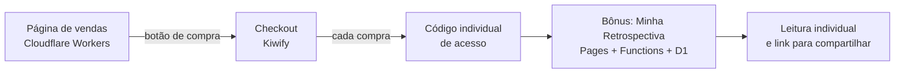

<h1 align="center">O Azevedo</h1>

  <strong>Produtos digitais · Segurança de aplicações · Qualidade de software</strong> 
  Da página de vendas ao pagamento confirmado no servidor: produtos no ar, testados, versionados e construídos com atenção à segurança.

  <a href="#-projeto-principal-cocrie-seu-ano">Projeto principal</a> ·
  <a href="#outros-produtos-no-ar">Produtos no ar</a> ·
  <a href="#em-desenvolvimento">Em desenvolvimento</a> ·
  <a href="#jogos">Jogos</a> ·
  <a href="#situação-dos-projetos">Situação</a> ·
  <a href="#competências">Competências</a> ·
  <a href="#contato">Contato</a>

  
  
  
  
  
  
  
  
  
  
  
  
  

---

## Perfil

Sou estudante de **cibersegurança** e desenvolvedor. Construo **produtos digitais que vendem e entregam sozinhos**: página de vendas, pagamento, acesso controlado e entrega, com a regra de negócio garantida no servidor e não na tela.

Trabalho na interseção entre **segurança, engenharia e experiência de uso**: entender o problema, construir a solução, integrar serviços (Kiwify, Mercado Pago, Mercado Livre), testar os casos esperados e os inesperados e publicar na **Cloudflare** (Workers, Pages, D1, R2), com banco **Neon (PostgreSQL)** quando o projeto pede.

Estudo segurança ofensiva e defensiva, participo de CTFs e treino no TryHackMe. Pratico apenas em sistemas próprios ou ambientes autorizados, com escopo definido e divulgação responsável.

## ⭐ Projeto principal: Co(Crie) Seu Ano

  

  
  

Um **método prático para planejar o ano** (e cumprir o plano), vendido como produto digital. Eu construí o produto de ponta a ponta: a página de vendas, a integração com o pagamento e o **app bônus**, a Minha Retrospectiva 2026, que é o primeiro passo do método. O conteúdo do método e os vereditos da Retrospectiva são da Kath.

### 🌅 [A página](https://cocrie-seu-ano.abertos2027.workers.dev) — Co(Crie) Seu Ano

<!-- auto:cocrie-versao -->v0.3.0<!-- /auto:cocrie-versao --> · HTML/CSS/JS sem build · Cloudflare Workers (static assets) · Kiwify

- **Página de vendas em um arquivo só**, sem framework: carrega rápido no celular, onde a venda acontece.
- Identidade própria (vinho e dourado metálico), contagem regressiva até o fim do ano, FAQ, CTA fixo no celular e cartão de compartilhamento para WhatsApp e redes.
- **Só a pasta `public/` vai ao ar.** A primeira versão publicava o repositório inteiro (README, changelog, workflow); a correção virou regra no `wrangler.jsonc`.
- Versão semântica, changelog e release com os arquivos nomeados pela versão a cada tag.

### 🎁 [O bônus](https://minha-retrospectiva-2026.pages.dev) — Minha Retrospectiva 2026

<!-- auto:retrospectiva-versao -->v0.5.2<!-- /auto:retrospectiva-versao --> · JavaScript · Cloudflare Pages · Functions · D1

Quiz de 15 perguntas que devolve uma leitura individual, montada por regras que cruzam as respostas, **sem IA**. As alternativas se ordenam arrastando, com animação, no celular e no PC.

- **Acesso só por código individual**: no primeiro uso ele fica ligado ao e-mail e é recusado em qualquer outro.
- **Uma resposta por código, contada no servidor**: limpar o navegador ou trocar de aparelho não libera outra.
- Sem uso simultâneo: entrar em outro aparelho encerra a sessão anterior.
- Link de compartilhamento que mostra só o resultado, sem nome, e-mail ou respostas.
- Dados pessoais com prazo de guarda definido (12 meses) e roteiro para pedidos de titulares (LGPD); liberação de nova resposta pelo suporte com um workflow do GitHub Actions; deploy automático depois dos testes.

## Outros produtos no ar

### 🔮 [Caminhos Abertos 2027](https://caminhos.abertos2027.workers.dev) — venda, pagamento e entrega

<!-- auto:caminhos-versao -->v1.0.1<!-- /auto:caminhos-versao --> · Next.js 16 · TypeScript · Cloudflare Workers · Neon (PostgreSQL) · Mercado Pago

Loja de uma análise personalizada para 2027, entregue em áudios e PDF. O fluxo vai da venda à entrega sem planilha nem conferência manual de comprovante.

- **O pedido só vira "pago" quando o servidor consulta o Mercado Pago** e confere status, valor, moeda e referência. Voltar para a página de sucesso ou mandar `status=approved` na URL não libera nada.
- Pix e cartão dentro do site pelo Checkout Transparente; formulário de personalização validado com Zod no navegador e de novo no servidor.
- Webhook com assinatura verificada, tolerante a duplicidade e a chegada fora de ordem; um cron reconcilia pagamentos cujo aviso se perdeu.
- Área administrativa com sessão assinada, rate limit por IP na borda, proteção CSRF e limpeza dos dados de pedidos não pagos (LGPD).
- Testes de cada cenário de pagamento (aprovado, pendente, recusado, estorno, valor divergente, Mercado Pago fora do ar) com Vitest e PGlite.

### 🛡️ [HackQuiz](https://hackquiz-blackbox.vercel.app) — aprendizagem em cibersegurança

<!-- auto:hackquiz-versao -->v1.5.5<!-- /auto:hackquiz-versao --> · HTML/CSS/JS · Firebase · Cloudflare Pages

Plataforma em português para estudar segurança da informação por competências: **<!-- auto:hackquiz-perguntas -->173<!-- /auto:hackquiz-perguntas --> perguntas em <!-- auto:hackquiz-materias -->9<!-- /auto:hackquiz-materias --> matérias**, **<!-- auto:hackquiz-exercicios -->30<!-- /auto:hackquiz-exercicios --> exercícios práticos** e um glossário de <!-- auto:hackquiz-termos -->57<!-- /auto:hackquiz-termos --> termos, com explicações referenciadas e repetição espaçada.

- Red Team e Blue Team, redes, criptografia, Linux e Windows, forense, GRC e Direito Digital, com exercícios baseados em artefatos.
- Regras do Firestore testadas no emulador, cobrindo acessos legítimos e tentativas não autorizadas.
- Correções de segurança reais no próprio app, como XSS armazenado e injeção causada pelo tratamento de caracteres Unicode.
- CSP sem `unsafe-inline`, cabeçalhos de segurança na borda, auditoria de acessibilidade e de contraste (WCAG AA) e CI.

## Em desenvolvimento

| Projeto | O que é | O que mostra | Tecnologias |
|---|---|---|---|
| **FinApp** | Educação e organização financeira, em português e inglês (nome provisório "Grana no Controle") | App full-stack com contas, isolamento de dados por usuário testado, limite de tentativas de login e migração para a Cloudflare com Prisma no Neon por HTTP | Next.js 16 · TypeScript · Prisma · PostgreSQL · Cloudflare Workers |

## Jogos

Projetos em que exercito arquitetura de conteúdo, simulação e testes automatizados fora do contexto web.

| Jogo | Descrição | Tecnologias |
|---|---|---|
| [⚔️ Runas & Hordas](https://runas-e-hordas.pages.dev) | Survivor-like de fantasia medieval: 12 armas, runas ativáveis, chefes por capítulo e save na nuvem; 96 testes da lógica e simulação com bot | HTML5 Canvas · JavaScript · Cloudflare Pages |
| [🌅 Ilumbá](https://ilumba.vercel.app) | RPG 2D de vida e pós-vida; conteúdo em JSON separado da lógica e simulação de vidas inteiras no CI | Godot 4 · GDScript |
| [🌙 Sombraluz](https://sombraluz.pages.dev) | Survivor-like com cidade, classes, equipamentos e ranking online; versão própria para o portal CrazyGames, com anúncios e save pelo SDK | HTML5 Canvas · JavaScript · Firebase · PWA |
| Tharveth *(em desenvolvimento)* | RPG de fantasia sombria para Roblox, com testes de lógica e simulação de combate com latência | Luau · Rojo · Lune |
| Firewall FPS *(em desenvolvimento)* | FPS cooperativo de sobrevivência contra hordas | Unity 6 · C# · FishNet |

## Situação dos projetos

<!-- auto:status -->

| Projeto | Versão | Lançada em | Commits (30 dias) | Site |
|---|---|---|---|---|
| **[Co(Crie) Seu Ano](https://cocrie-seu-ano.abertos2027.workers.dev)** | v0.3.0 | 14/11/2026 | — |  |
| **[Minha Retrospectiva 2026](https://minha-retrospectiva-2026.pages.dev)** | v0.5.2 | 13/11/2026 | — |  |
| **[Caminhos Abertos 2027](https://caminhos.abertos2027.workers.dev)** | v1.0.1 | 13/11/2026 | — |  |
| **[HackQuiz](https://hackquiz-blackbox.vercel.app)** | v1.5.5 | 29/10/2026 | — |  |
| **[Runas & Hordas](https://runas-e-hordas.pages.dev)** | v0.24.0 | 07/11/2026 | — |  |
| **[Ilumbá](https://ilumba.vercel.app)** | v0.98.0 | 06/11/2026 | — |  |
| **[Sombraluz](https://sombraluz.pages.dev)** | v0.45.1 | 31/10/2026 | — |  |

<!-- /auto:status -->

Tabela, versões e números do HackQuiz atualizados por uma GitHub Action deste repositório. Última mudança: <!-- auto:atualizado -->14/11/2026<!-- /auto:atualizado -->.

## Competências

| Área | Competências e prática |
|---|---|
| **Produtos digitais** | Página de vendas com foco em conversão no celular, checkout (Kiwify, Mercado Pago), entrega automatizada, acesso por código e LGPD |
| **Segurança de aplicações** | OWASP Top 10, XSS e injeção, validação de entrada, controle de acesso, regras do Firestore, CSP, HSTS, clickjacking, cookies, cabeçalhos HTTP e IP confiável atrás de proxy |
| **Testes e QA** | Testes unitários e de integração, regressão, testes de regras de segurança e de cenários de pagamento, simulação automatizada e CI |
| **Desenvolvimento web** | JavaScript, TypeScript, HTML/CSS, Next.js, aplicações responsivas, PWA e acessibilidade (WCAG AA) |
| **Integração de APIs** | Kiwify, Mercado Pago (checkout, webhooks e conferência do pagamento no servidor), Mercado Livre; validação com Zod |
| **Dados e backend** | Neon/PostgreSQL, Prisma, Drizzle, Cloudflare D1, Firebase/Firestore; regras de acesso e validação no servidor |
| **Cloud** | Cloudflare Workers, Pages, D1, R2 e Web Analytics; OpenNext para Next.js na borda; cabeçalhos e segredos por ambiente |
| **Entrega e automação** | Git, GitHub Actions, CI, versionamento semântico, changelog, releases e deploy por tag |
| **Fundamentos de segurança** | Redes, criptografia, Linux, Windows, forense, GRC, LGPD, CTFs e prática em laboratório |
| **Jogos** | Godot 4/GDScript, Unity/C#, HTML5 Canvas, Luau/Roblox; combate, progressão, conteúdo e simulação |

## Como trabalho

- **Regra de negócio no servidor:** clique, redirecionamento ou comprovante não liberam nada sozinhos; quem decide é o servidor, conferindo na fonte.
- **Qualidade verificável:** testes, simulações e CI para pegar regressões e validar regras, não só o caminho feliz.
- **Segurança desde o desenho:** abuso, autorização e validação fazem parte da funcionalidade, não de uma revisão no fim.
- **Engenharia com critério:** decisões técnicas documentadas, para que mudanças futuras respeitem o contexto do projeto.
- **Entrega versionada:** cada mudança integrada vira versão, changelog e release com os arquivos nomeados pela versão.
- **IA como ferramenta:** uso assistência de IA para acelerar o trabalho, mantendo comigo as decisões, a revisão e a responsabilidade pelo resultado.

## Contato

Aberto a conversar sobre **produtos digitais, segurança de aplicações, QA, integração de pagamentos e desenvolvimento web**, além de oportunidades e projetos técnicos.

[Abra uma issue neste repositório](https://github.com/O-Azevedo/O-Azevedo/issues/new) para entrar em contato.

Construir com intenção. Testar com rigor. Integrar com cuidado. Publicar com responsabilidade.

